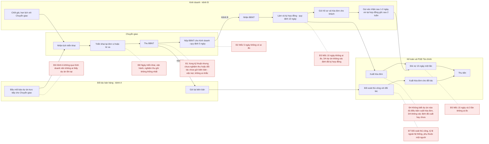
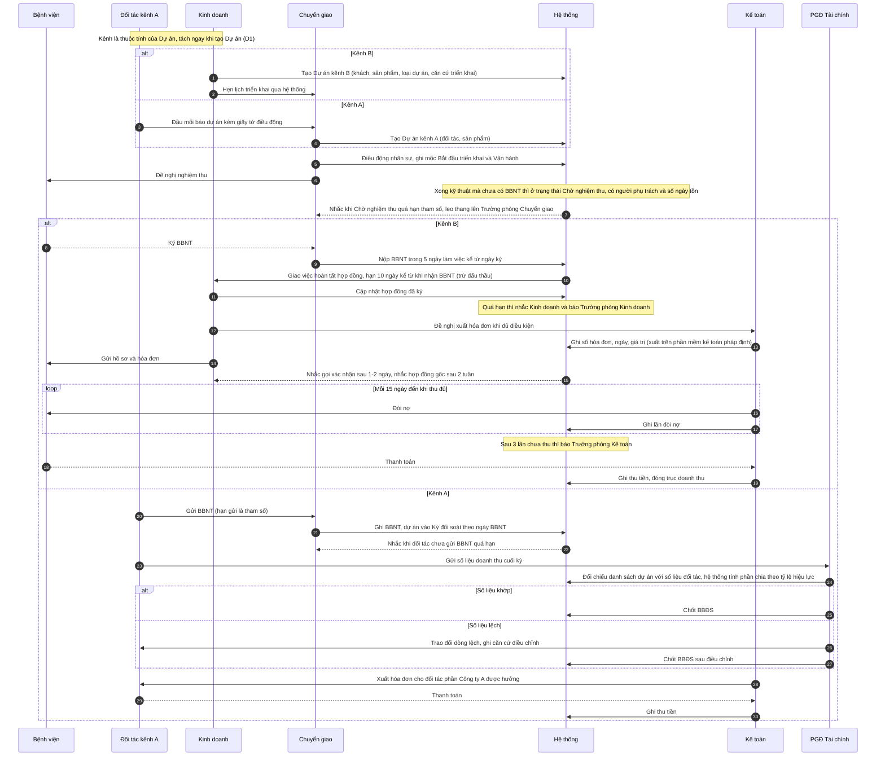
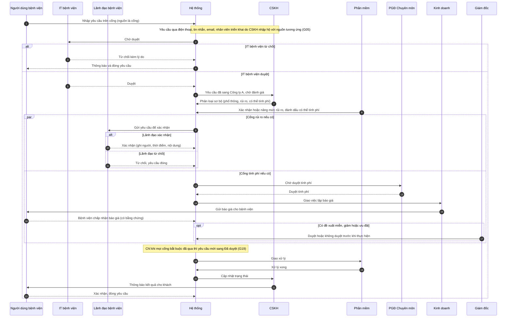
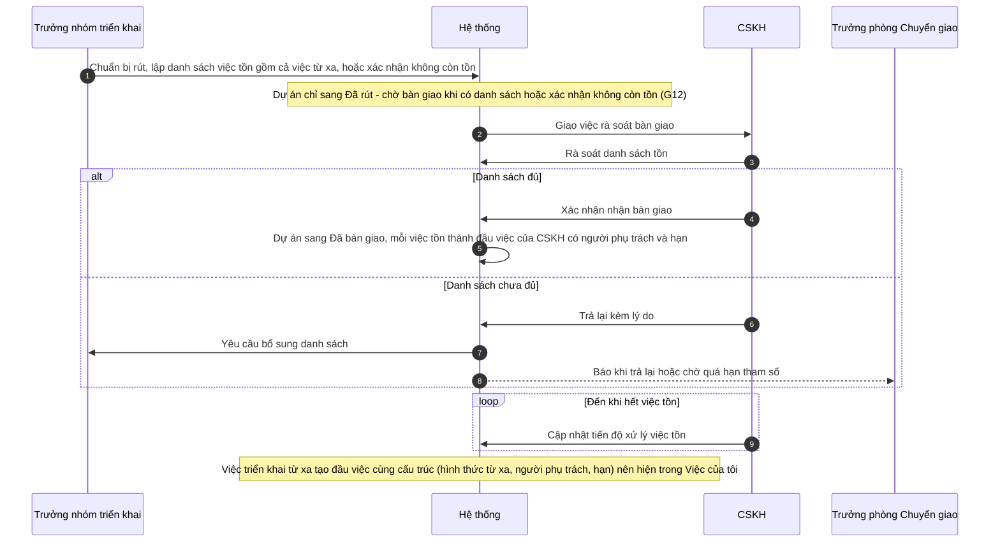
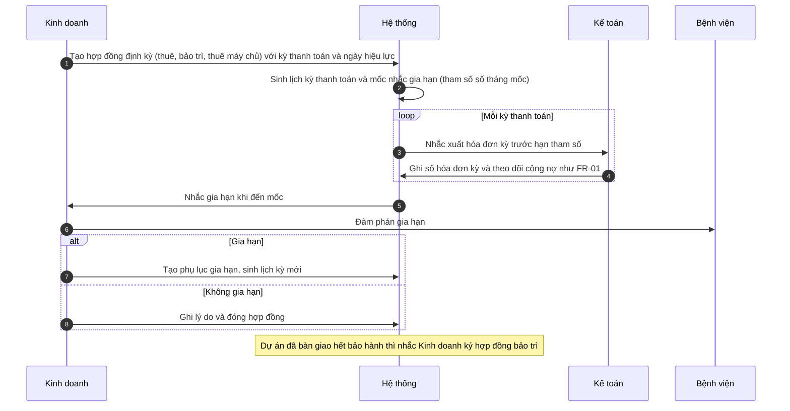
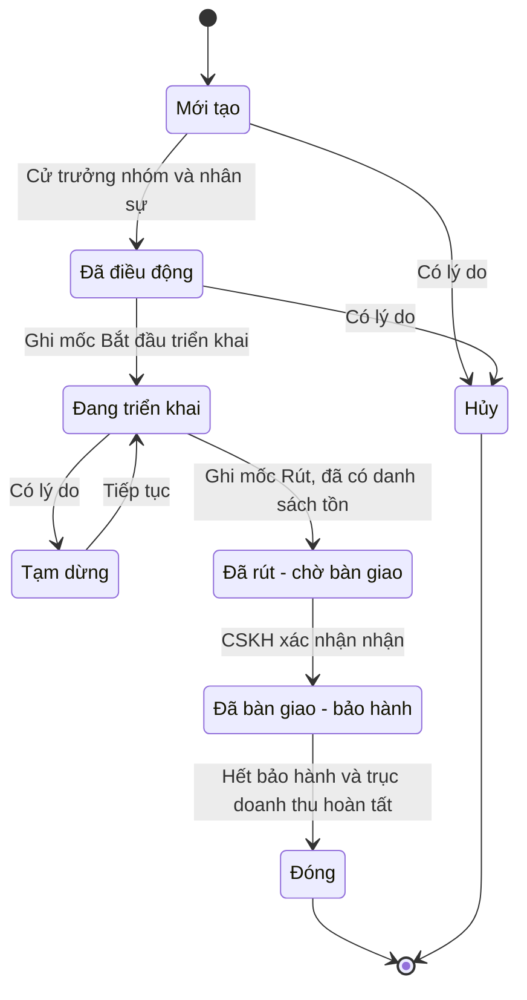
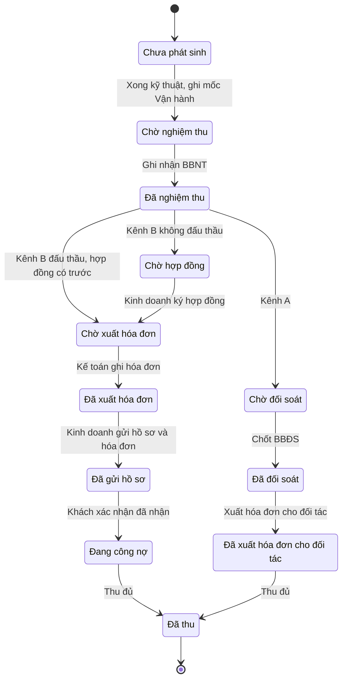
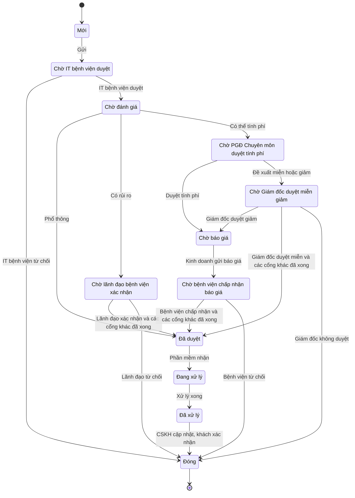
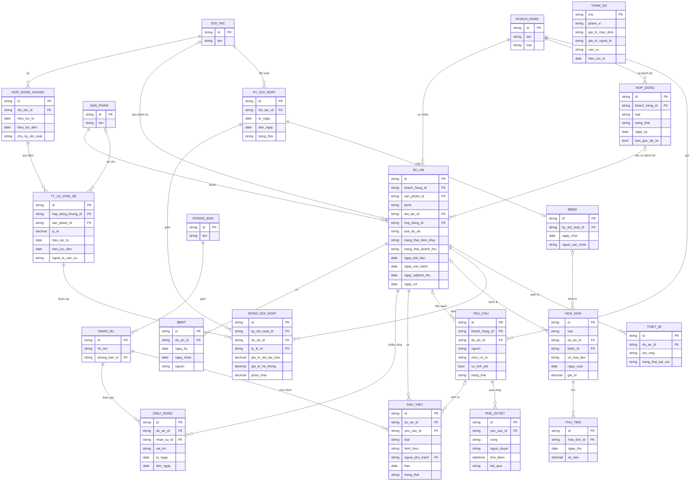

# Bộ sơ đồ — ERP Công ty A (Phần A)

> Toàn bộ sơ đồ viết bằng **Mermaid**, tách ra từ tài liệu Phần A. Mã hình khớp với tham chiếu trong file Word (Hình A.2, A.3.1…).
> Xem/xuất ảnh: dán từng khối vào https://mermaid.live, hoặc dùng draw.io (Arrange → Insert → Advanced → Mermaid), hoặc mở file này trong trình xem Markdown có hỗ trợ Mermaid (VS Code, GitHub, Obsidian).
> Mỗi cột trong sơ đồ tuần tự là một **làn (phòng ban)**. Thời hạn mặc định 5/10/15 ngày, 1–2 ngày, 2 tuần, 3 lần lấy từ quy định hiện hành; hạn chưa có trong đề ghi là tham số.

## Mục lục

- Hình A.2: Sơ đồ luồng hiện tại (AS-IS)
- Hình A.3.1: Dự án → doanh thu, tách kênh A và kênh B (FR-01, FR-02)
- Hình A.3.2: Yêu cầu khách hàng qua cổng, có nhánh rủi ro và nhánh tính phí (FR-03)
- Hình A.3.3: Bàn giao Triển khai → CSKH kèm danh sách việc tồn (FR-04)
- Hình A.3.4: Luồng tùy chọn — KK03 Hợp đồng định kỳ và gia hạn (FR-07, mức hướng đi)
- Hình A.4a: Dự án — trục Triển khai & bàn giao (FR-04, FR-01)
- Hình A.4b: Dự án — trục Nghiệm thu & doanh thu, rẽ nhánh kênh A/B (FR-01, FR-02)
- Hình A.4c: Yêu cầu (FR-03)
- Hình A.5: Mô hình dữ liệu khái niệm

---

## Hình A.2 — Sơ đồ luồng hiện tại (AS-IS)

## Hình A.3.1 — Dự án → doanh thu, tách kênh A và kênh B (FR-01, FR-02)

## Hình A.3.2 — Yêu cầu khách hàng qua cổng, có nhánh rủi ro và nhánh tính phí (FR-03)

## Hình A.3.3 — Bàn giao Triển khai → CSKH kèm danh sách việc tồn (FR-04)

## Hình A.3.4 — Luồng tùy chọn — KK03 Hợp đồng định kỳ và gia hạn (FR-07, mức hướng đi)

## Hình A.4a — Dự án — trục Triển khai & bàn giao (FR-04, FR-01)

## Hình A.4b — Dự án — trục Nghiệm thu & doanh thu, rẽ nhánh kênh A/B (FR-01, FR-02)

## Hình A.4c — Yêu cầu (FR-03)

## Hình A.5 — Mô hình dữ liệu khái niệm

